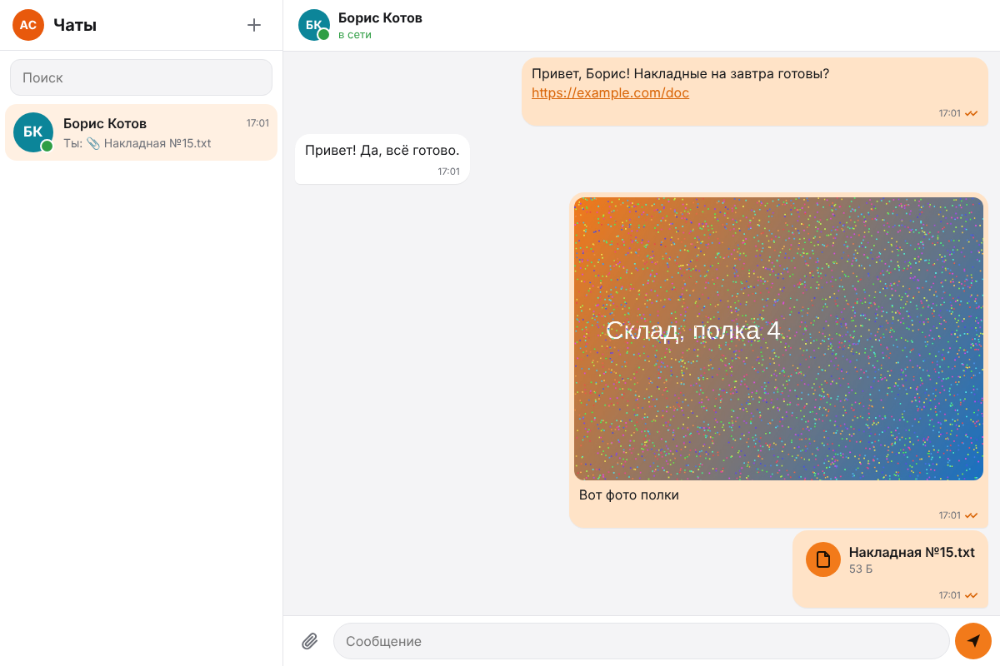

# Апельсин 🍊

Рабочий мессенджер: открывается в браузере и ставится на телефон как приложение (Android и iPhone).

## Что умеет
- **Личные и групповые чаты**, сообщения приходят мгновенно.
- **Фото и файлы** до 25 МБ. Большие фото сами уменьшаются перед отправкой.
- **Галочки**: ✓ отправлено, ✓✓ прочитано. Видно, кто **в сети** и когда был последний раз.
- **Уведомления** о новых сообщениях, даже когда мессенджер закрыт.
- **Вход только по приглашению**: чужой человек не зарегистрируется без кода.
- **Сотрудники по отделам** и поиск по имени, отделу, должности.
- **Администратор** (тот, кто зарегистрировался первым) видит код приглашения, может сменить его, закрыть доступ уволившемуся и назначить других админов.
- Удаление своих сообщений у всех, повтор отправки при плохой связи, светлая и тёмная тема.

Всё работает на бесплатных тарифах: база на Supabase, сайт на GitHub Pages.

---

## Запуск (один раз, минут 15)

### 1. База в Supabase
1. На https://supabase.com нажми **New project**, тариф **Free**, регион ближайший (например Frankfurt). Лучше завести **отдельный проект**, а не тот, где Планер: у мессенджера свои пользователи.
2. **SQL Editor → New query**: вставь всё содержимое [`supabase/schema.sql`](supabase/schema.sql) и нажми **Run**.
3. **Authentication → Sign In / Providers → Email**: выключи **Confirm email** и сохрани. Иначе никто не сможет зарегистрироваться без письма с подтверждением.

### 2. Адрес и ключ
В **Project Settings → API** (или кнопка **Connect**) скопируй:
- **Project URL** вида `https://xxxx.supabase.co`;
- публичный ключ: **Publishable key** или **anon public**. Секретный `service_role` не нужен.

Вставь оба значения в [`config.js`](config.js). Эти значения не секретные, их можно хранить в репозитории.

### 3. Сайт на GitHub Pages
1. В репозитории: **Settings → Pages → Source: GitHub Actions**.
2. После этого сайт сам публикуется при каждом изменении в ветке `main` (workflow `Publish site`). Адрес появится в **Settings → Pages**, обычно это `https://<логин>.github.io/apelsin/`.

> GitHub Pages бесплатен только для **публичных** репозиториев. Секретов в коде нет: ключ в `config.js` публичный по своей природе.

### 4. Первый вход
1. Открой сайт и нажми **«Зарегистрироваться»**. Первый зарегистрировавшийся становится **администратором**, код ему не нужен.
2. Нажми на свой кружок слева вверху → **Настройки → Приглашение коллег → Скопировать ссылку** и разошли её коллегам.

### 5. Уведомления (по желанию, 3 минуты)
1. В Supabase: **Edge Functions → Deploy a new function → Via Editor**.
2. Имя функции: `push`. Вставь содержимое [`supabase/functions/push/index.ts`](supabase/functions/push/index.ts) и нажми **Deploy**.
3. В настройках функции выключи **Verify JWT** (функция сама проверяет, кто её вызывает).
4. Каждый сотрудник у себя: **Настройки → Включить уведомления**.

Ключи для уведомлений функция создаёт сама, вручную ничего настраивать не нужно.

---

## Как поставить на телефон
- **Android (Chrome)**: открой сайт → меню «три точки» → **Установить приложение**.
- **iPhone (Safari)**: открой сайт → **Поделиться** → **На экран «Домой»**. На iPhone уведомления работают **только** из установленного так приложения.

## Что стоит знать
- Бесплатный Supabase ставит проект на паузу, если им не пользоваться около недели. Если мессенджер перестал открываться после отпуска, зайди на supabase.com и нажми **Restore project**.
- Бесплатные лимиты: 1 ГБ на файлы, 500 МБ на базу, до 200 человек онлайн одновременно. Для команды в несколько десятков человек этого хватает надолго.
- Сброса пароля по почте нет. Если сотрудник забыл пароль, администратор Supabase может задать новый в **Authentication → Users**.
- Переписка хранится в базе Supabase и защищена правами доступа: каждый видит только свои чаты. Сквозного шифрования нет, то есть владелец проекта Supabase технически может прочитать базу.

## Для разработки
- Без сборки: обычные `index.html`, `app.js`, `app.css`. Библиотека Supabase лежит в `vendor/`.
- `sw.js`: кеш оболочки приложения и показ пуш-уведомлений.
- `supabase/schema.sql`: таблицы, права доступа (RLS), функции. Скрипт можно запускать повторно.
- `supabase/functions/push`: рассылка Web Push без сторонних библиотек (шифрование RFC 8291 на WebCrypto).
